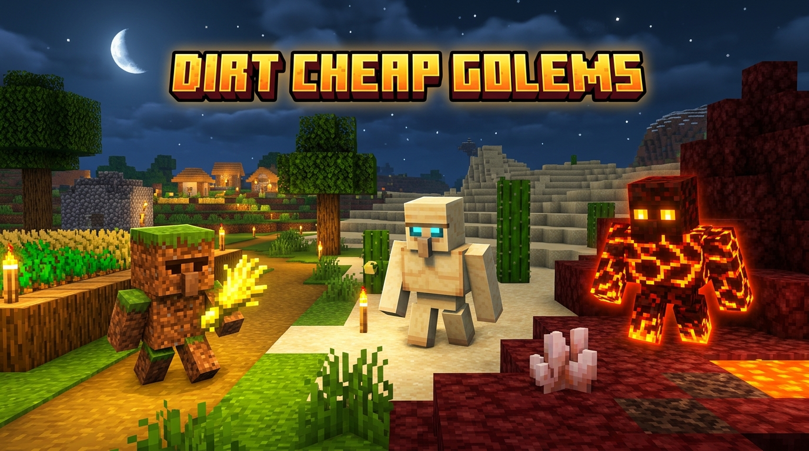
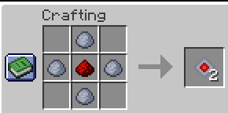
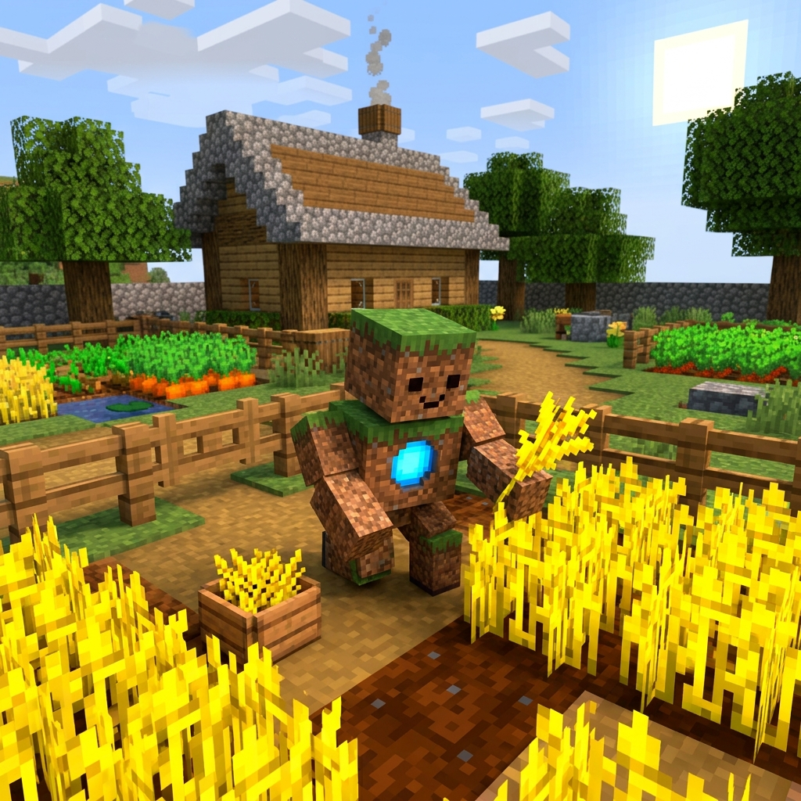
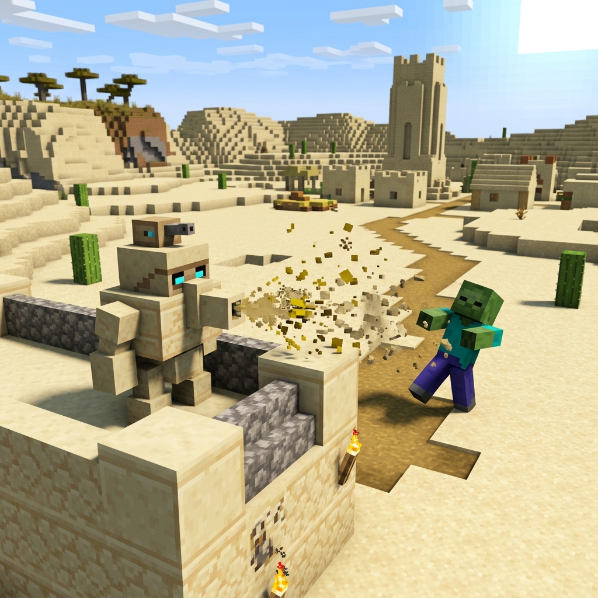
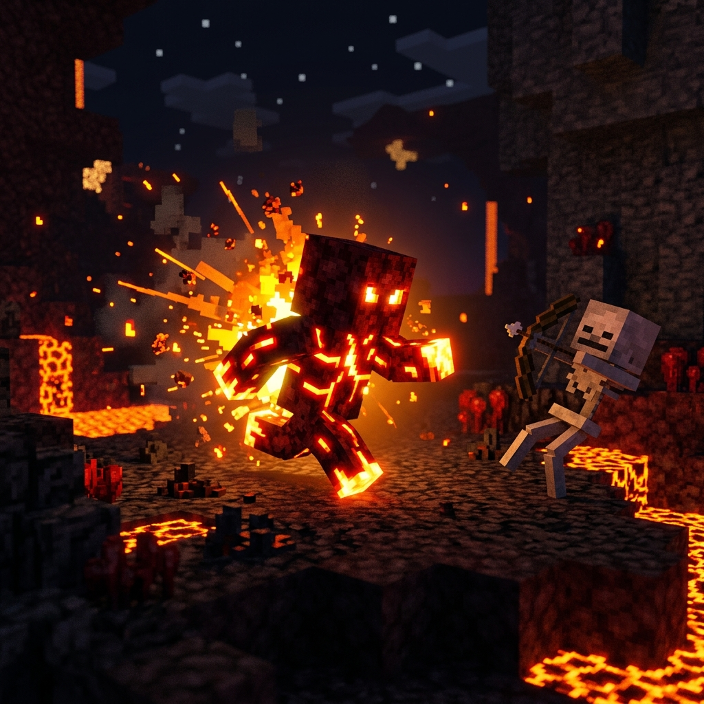
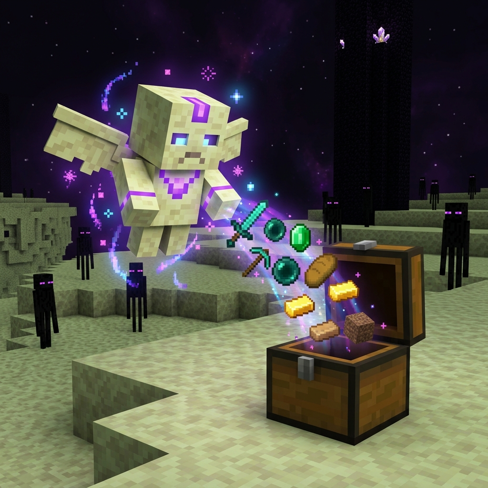
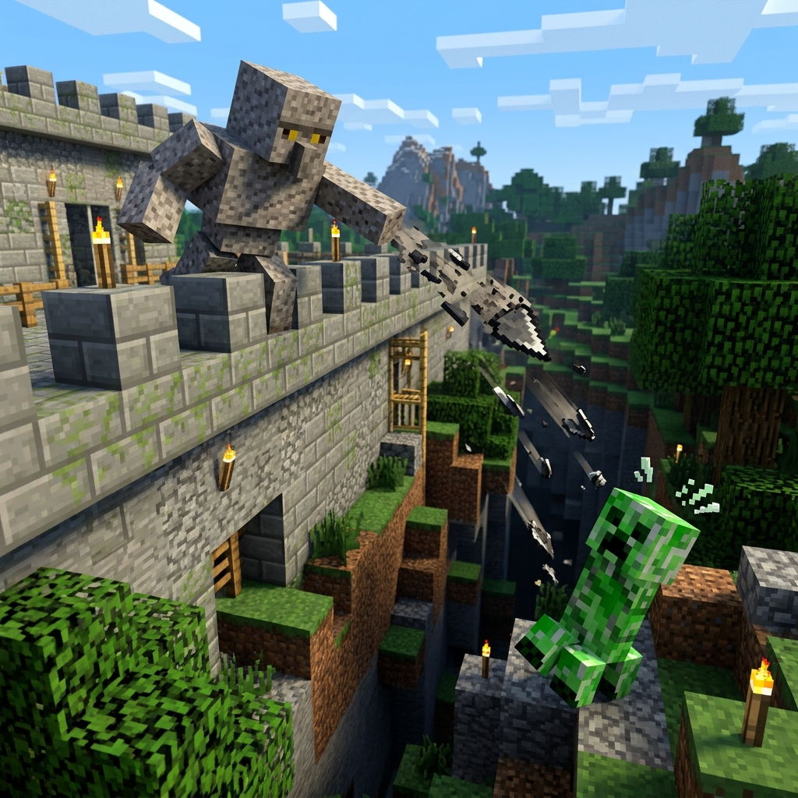
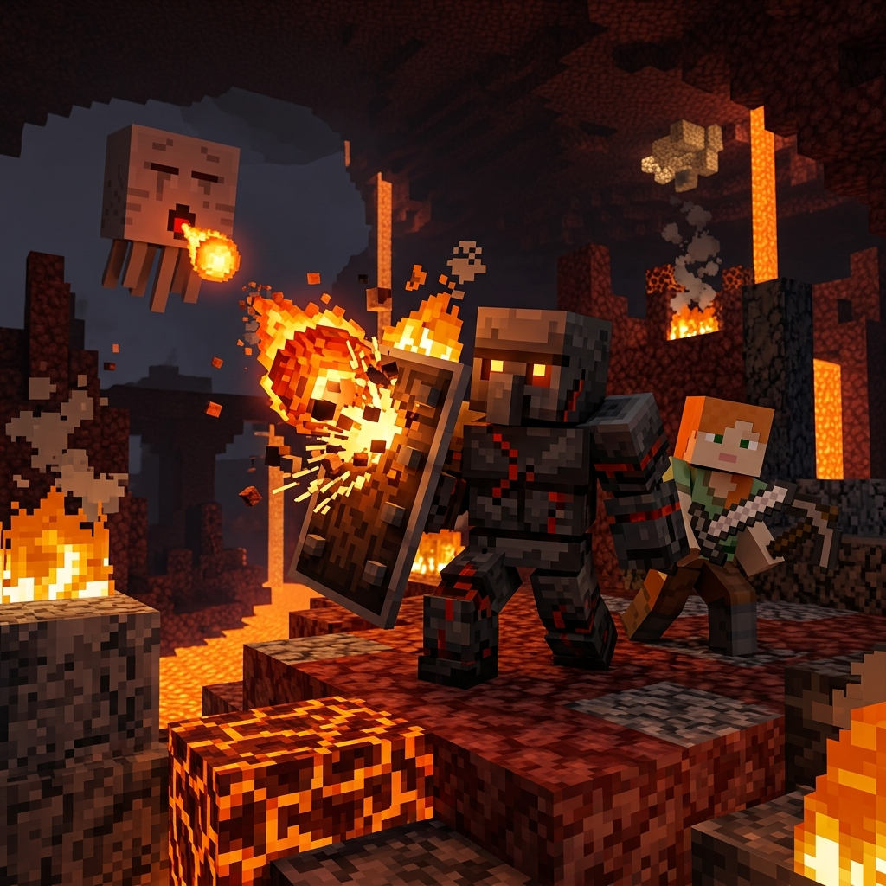

# Dirt Cheap Golems

[Português (Brasil)](README.pt-BR.md)

> Turn the blocks nobody wants (dirt, sand, netherrack, gravel, basalt, end stone) into tiny servant golems. They work hard, wear out, and you build more.

**Minecraft 26.3 · Forge 66.0.9 · v2.0.0**

Every survival world ends up with chests full of dirt, sand, netherrack, gravel, basalt and end stone. Dirt Cheap Golems gives those blocks a job: two blocks and a cheap core become a small golem that farms, defends or lights up your base. The catch: **golems are disposable**. They wear out as they work, as time passes and when the weather turns against them, so you keep coming back for more blocks.

---

## Golem Core

The only crafted item in the mod. It brings a pillar of blocks to life.

| | | |
|:-:|:-:|:-:|
| | Clay Ball | |
| Clay Ball | Redstone Dust | Clay Ball |
| | Clay Ball | |

**Yields 2 Golem Cores.**

## Creating a golem

1. Stack **two blocks of the same material**, one on top of the other.
2. Use a **Golem Core** on either block.
3. The pillar disappears and the golem appears where the bottom block was. That spot becomes its **home**.

- Mixed pillars (e.g. dirt on top of sand) do nothing, and the core is not consumed. Use a normal click: **sneaking never creates a golem** (see [Commanding golems](#commanding-golems)).
- In creative mode the core is not consumed.
- Players who can't build at that spot (adventure mode, spawn protection) can't create golems.

| Material | Golem |
|---|---|
| Dirt, Coarse Dirt | Dirt Golem |
| Sand, Red Sand | Sand Golem |
| Netherrack | Netherrack Golem |
| End Stone | End Stone Golem |
| Gravel | Gravel Golem |
| Basalt, Polished Basalt, Smooth Basalt, Deepslate, Cobbled Deepslate (mixable) | Basalt Golem |

## Commanding golems

The Golem Core also has a **command mode**, used while **sneaking**:

| Action | Result |
|---|---|
| Click a block (not sneaking) | **Activation**: creates a golem from a pillar |
| Sneak + click a block **with an inventory** (chest, barrel, shulker box, modded storage) | **Links** that block to the core (enchantment glint and tooltip show the target) |
| Sneak + click any other block | Nothing. It never creates a golem |
| Sneak + click a golem | Gives the golem an **order** (e.g. switches the Basalt Golem's mode) |
| Sneak + click the air | **Clears** the link |

> **Changed in 2.0.0:** sneak-clicking a pillar **no longer creates a golem**. Use a normal click.

Commands never consume the core. The link is stored on the item stack, so it applies to every core in that stack. The Golem Core recipe also shows up in the recipe book.

---

## The golems

### Dirt Golem: the Farmhand

Wanders around its home looking for **mature crops** (wheat, carrots, potatoes, beetroot), harvests them and **replants** using one seed from the drops. Everything else stays on the ground for you to collect. It never tramples farmland.

- **Wears out:** 1 integrity per harvest.
- **Weakness:** it **melts in rain** (−2 integrity/s) and in water (−4/s). When it starts raining it looks for a covered spot nearby and stops harvesting until the rain is over.
- **Crumbles into:** 50% chance of 1 Dirt.

### Sand Golem: the Turret

A stationary defense tower. It **never moves** and can't be knocked back. It fires sand blasts at **hostile mobs** within 12 blocks that it can see. Blasts fly through players, villagers and other friendly mobs.

Each hit deals 1 damage and applies:
- **Slowness II** for 4 s.
- **Sand in Eyes** for 3 s: the mob **loses its target** and its follow range drops by **75%**.

- **Wears out:** 2 integrity per shot (about 45 shots).
- **Weakness:** none. It's the sturdiest golem; it pays with every shot.
- **Crumbles into:** 50% chance of 1 Sand.

### Netherrack Golem: the Thermal Kamikaze

A **walking light** (light level 12) that patrols your base. When a hostile mob comes within 10 blocks, it charges, hugs it and, after a short hiss, releases a **thermal blast**: 4 fire damage and 5 s of burning to every hostile mob within 3 blocks.

- The blast **never breaks blocks** or starts fires, and never hurts players, golems or passive mobs.
- The golem is immune to fire and lava.
- **Wears out:** 34 integrity per blast. **3 blasts and it's ash.**
- **Weakness:** if it touches **water or rain**, it instantly turns into a block of **Stone**.
- **Crumbles into:** 1 Charcoal.

### End Stone Golem: the Collector

A **flying** golem that hovers 0.5 to 1.5 blocks above the ground when idle. Link a container to a core (sneak + click a chest), then create the golem with a core from that same stack: it **collects dropped items within its home radius and teleports them into the linked container**.

- The container must be within **32 blocks of the golem's home**, in the same dimension.
- It ignores items that still have a pickup delay (like a player's just-thrown drops).
- If the container is broken, the link is cleared and it stops collecting.
- **Wears out:** 1 integrity per **4 items**.
- **Crumbles into:** 50% chance of 1 End Stone.

### Gravel Golem: the Artillery

A mobile artillery piece. It throws **flint shards** at **hostile mobs** up to **16 blocks** away, preferring targets **lower** than itself (walls and towers are its home turf). Shards fly through players, villagers and other non-hostiles.

Each hit deals 3 damage and applies **Slowness I** for 3 s.

- **Leap:** when a hostile gets close, or sits below it within reach, the golem **leaps** onto it and **buries it under falling gravel**. Gravel is only placed into air and respects the `mobGriefing` game rule and the `leapPlacesBlocks` config option; otherwise it drops gravel items instead.
- **Wears out:** 3 integrity per shot.
- **Crumbles into:** 50% chance of 1 Gravel.

### Basalt / Deepslate Golem: the Shield

A living shield for **its owner**, the player who created it. Build a pillar from any mix of basalt, polished basalt, smooth basalt, deepslate or cobbled deepslate. Golems from spawn eggs have no owner and stay in GUARD.

Two modes, switched by **sneak + core on the golem** (**only the owner** can do this):
- **FOLLOW:** follows the owner and moves to intercept ranged threats aimed at them.
- **GUARD:** holds position near its home.

It **absorbs hostile-mob projectiles** that come within 2.5 blocks. Cost per projectile: arrow or trident 4, small fireball 6, ghast fireball 15 (it does **not** explode), anything else 4. A melee hit costs 2.

- **Crumbles into:** 50% chance of its **source block** (the bottom block of the pillar).

---

## Integrity: why golems don't last

Each golem has **integrity** (0–100), separate from its health.

- It **only goes down**: by working, by its weakness, and passively (−1 every 30 s, roughly 50 minutes if idle).
- Healing and potions restore health, **never** integrity. There is no repair.
- **Cracks** appear on the golem at 66 and at 33 integrity.
- At 0 integrity, or when its health runs out, the golem **crumbles** and may drop part of its material.

Golems stay within **16 blocks of their home**, and they never attack players, other golems or passive mobs.

## Configuration

Every balancing number is in `config/dirtcheapgolems-common.toml`, with safe limits: passive decay, home radius, cost of each action, ranges, damage, effect durations and drop chances.

Which blocks create each golem is controlled by block tags and can be changed with a datapack:

| Tag | Default |
|---|---|
| `#dirtcheapgolems:materials/dirt` | `dirt`, `coarse_dirt` |
| `#dirtcheapgolems:materials/sand` | `sand`, `red_sand` |
| `#dirtcheapgolems:materials/netherrack` | `netherrack` |
| `#dirtcheapgolems:materials/end_stone` | `end_stone` |
| `#dirtcheapgolems:materials/gravel` | `gravel` |
| `#dirtcheapgolems:materials/basalt` | `basalt`, `polished_basalt`, `smooth_basalt`, `deepslate`, `cobbled_deepslate` |

---

## Development

Requires JDK 21+ to launch Gradle; the build uses a Java 25 toolchain (downloaded automatically). On Windows use `gradlew.bat`.

| Command | What it does |
|---|---|
| `gradlew build` | Compiles and builds the jar |
| `gradlew test` | JUnit tests (pure logic) |
| `gradlew runData` | Datagen: translations and GameTest instances into `src/generated/resources` |
| `gradlew runGameTestServer` | Runs all GameTests on a dedicated server; exits non-zero on failure |
| `gradlew runClient` / `gradlew runServer` | Dev client / dedicated server |

**Run `gradlew runData` before `runGameTestServer` whenever a GameTest is added or renamed.** See [`gametest/README.md`](src/main/java/com/josebieco/dirtcheapgolems/gametest/README.md) for how tests are registered.

Placeholder textures are generated by `python tools/gen_textures.py`.

Design specs: [v1](docs/specs/2026-10-09-dirt-cheap-golems-design.md), [v2](docs/specs/2026-10-09-dirt-cheap-golems-v2-design.md)

## Author

José Eduardo Saroba Bieco
